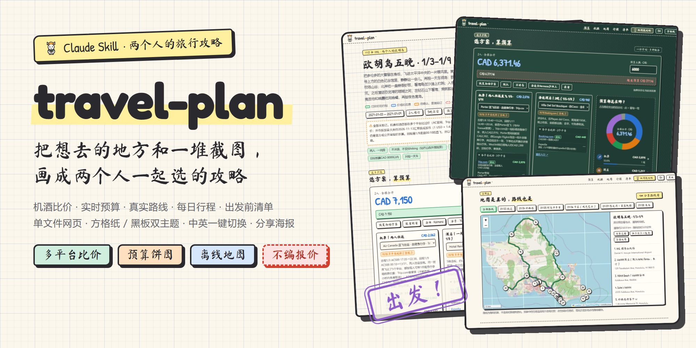
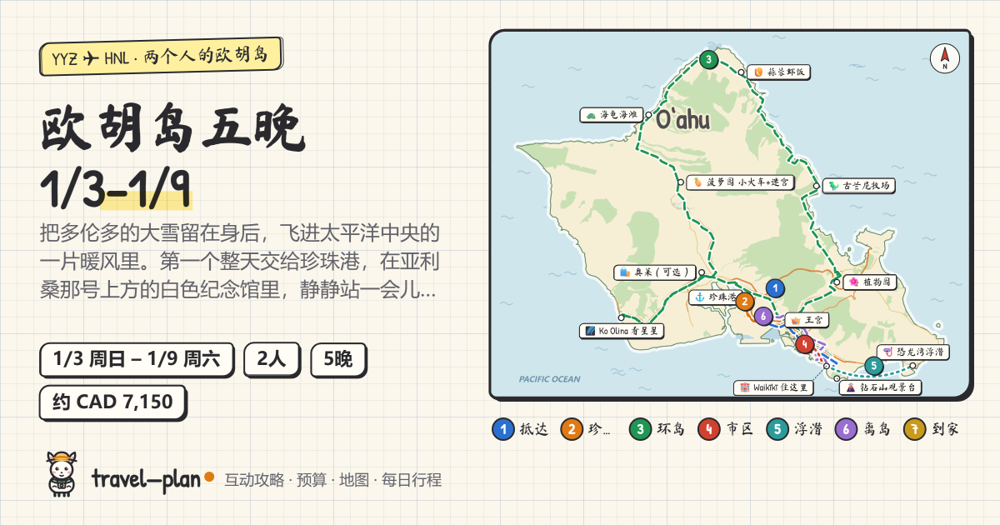
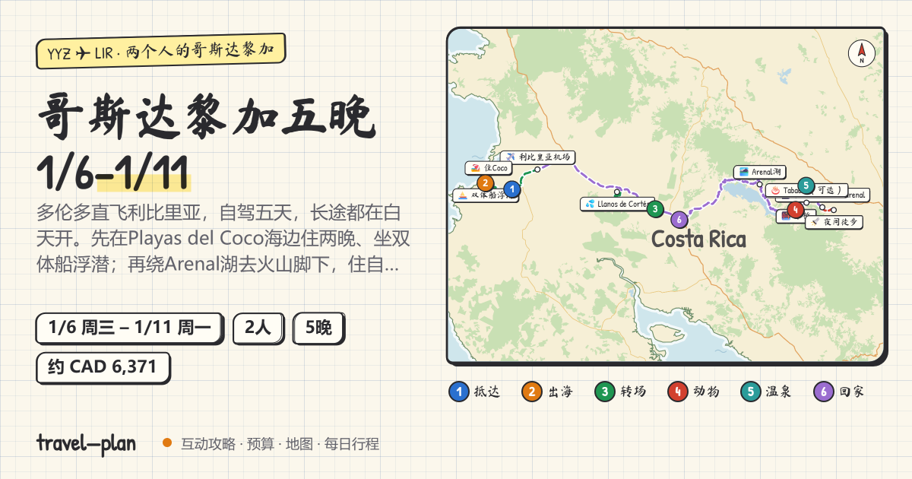
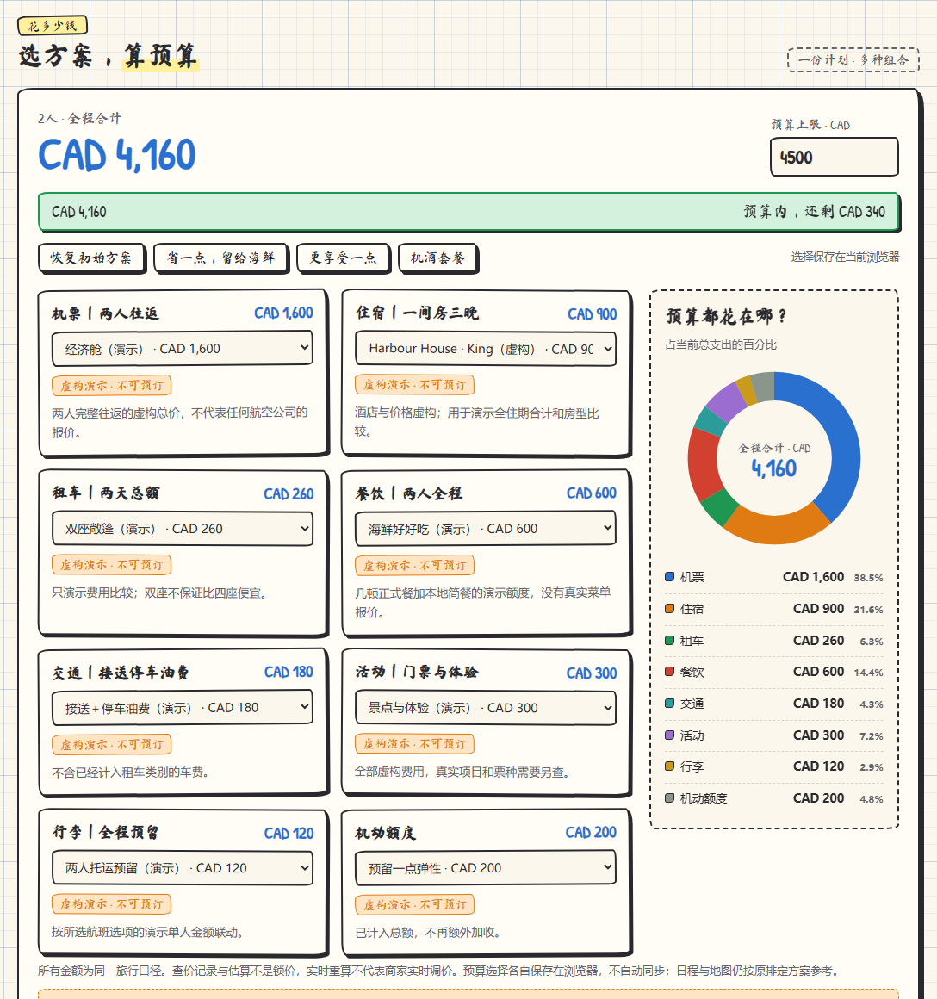
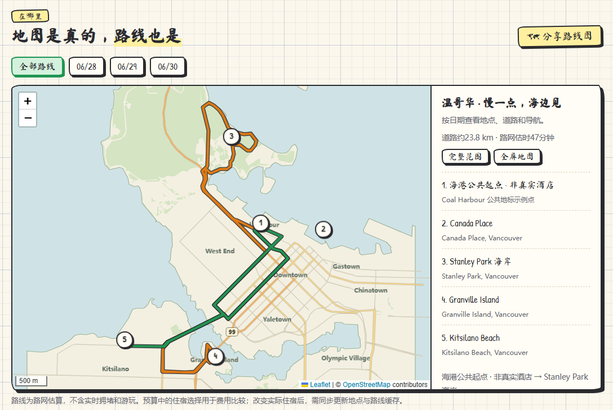
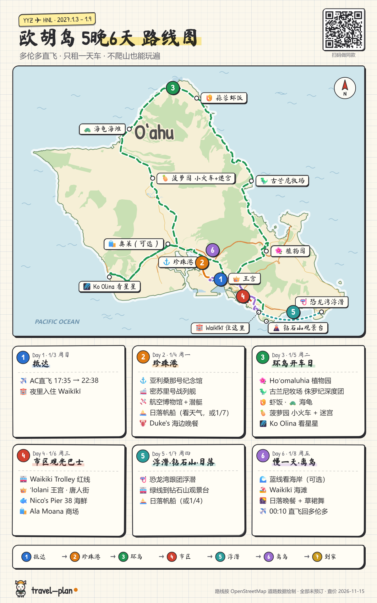

<div align="center">

<a href="https://stevensun1005.github.io/travel-plan/demo/"></a>

[](https://github.com/stevensun1005/travel-plan/actions/workflows/check.yml)


[](LICENSE)

[**Oʻahu demo →**](https://stevensun1005.github.io/travel-plan/demo/?lang=en) · [**Costa Rica demo →**](https://stevensun1005.github.io/travel-plan/costa-rica/?lang=en) · [Install in one message](#install-in-one-message) · [中文](README.md)

</div>

---

Trip planning starts out scattered: an old PDF, a few flight screenshots, saved places, and the things you only said once in a chat, like "not too rushed", "don't blow the budget", "she can't do hikes".

**travel-plan** is a travel-planning skill for Claude and Codex. Hand it all of that: it checks real prices and routes, builds days you can actually manage, and gives you a web page. Pick the flights and hotels yourselves, watch the budget follow, see real roads on the map, and send the link to whoever is coming with you.

## Two real trips

| [](https://stevensun1005.github.io/travel-plan/demo/?lang=en) | [](https://stevensun1005.github.io/travel-plan/costa-rica/?lang=en) |
| :--- | :--- |
| **Oʻahu · five nights in January**<br>Leave the Toronto snow behind: stand quietly at Pearl Harbor for a while, loop the island for turtles and stars, then chase one more sunset under sail. | **Costa Rica · Jan 6–11**<br>Out of the Toronto cold and south: two nights to the sound of the Pacific, three nights by the hot springs at the foot of a volcano. |

Both are real plans made with travel-plan for two people; click a card to open one, no sign-in needed. Prices are records and estimates from mid-November 2026, and **nothing is booked**; the booking page has the final price.

## Install in one message

Rather not type commands? Copy this whole block and send it to the Claude Code or Codex session you already use; it will install the skill for you:

```text
Please install the travel-plan skill: https://github.com/stevensun1005/travel-plan
- If you are Claude Code: run git clone https://github.com/stevensun1005/travel-plan ~/.claude/skills/travel-plan
- If you are Codex: git clone the repository into a temporary folder, then run python scripts/install.py inside it
- If it is already installed, git pull in the installed folder to update it
Then read its SKILL.md and tell me how to start my first trip plan.
```

For claude.ai or the Claude desktop app, see [Install](#install) below.

## What it does for you

### Prices: the same ticket, checked in several places

- It first asks whether you want nonstop flights and whether you prefer an airline, then checks the same flight or room on the airline site, Trip.com, Booking.com, Expedia and Vio, takes the cheapest and names where it came from.
- Flights are always compared with one carry-on bag per traveler; foreign currencies are converted at Bank of Canada rates.
- Every price carries the date it was checked; anything it cannot find is marked as an estimate, never made up. Car rentals are priced for the driver's real age, licence and rental period, including young-driver fees and insurance.

### Budget: chosen together

- Flights, hotels and cars are options; switch one and the total and remaining budget update at once, with a warning when you go over.
- Pick a flight+hotel package and the hotel and transfers switch to "included", so nothing is counted twice.
- Every slice of the spending chart opens into line items, like an expense app; categories chosen separately, such as two hotels or the car and its fuel, can share one slice.
- A "Cash to bring" section says how many US dollars and how much local currency to carry, where to get them and where only cash works.

### Map: real roads, not sketches

- Places use real coordinates and routes come from the OpenStreetMap road network, with day filters, leg distances and one-tap directions.
- A bundled offline base map keeps land, roads and place names visible when a host blocks map tiles; zoom all the way out for a world map, and one button frames home and the destination together.
- Sightseeing buses, boats and park shuttles are never drawn as the shortest car route.

### Days and checklist: at your pace

- Places from old plans, PDFs and screenshots are merged one by one, with a reason for everything scheduled, swapped, kept as an option or dropped.
- "She doesn't hike" keeps normal sightseeing and only swaps out trails; "no long drives at night" puts the long drives in daylight.
- The pre-departure checklist looks up visas and entry rules for each traveler's passport and residency, adds the bookings that sell out, and sorts everything by deadline with a countdown.

### Sharing: looks good when sent, and friends can make their own

- "Share route map" draws a hand-drawn poster of each day's route, place stickers and highlights, with a QR code in the corner and a little alpaca at the bottom.
- A shared link shows a preview card with the route map in iMessage, WhatsApp, Telegram, Slack, Discord and claude.ai Artifacts.
- One button switches the whole page between Chinese and English, with no Chinese left in English mode; graph-paper and chalkboard themes; a layout made for phones.
- "Make your own" copies a prompt that a friend can paste into their own AI to make a page of their own.



| Offline base map | Share route poster |
| :---: | :---: |
| [](docs/assets/map.png) | [](docs/assets/share-poster.png) |
| Road classes · route shields · forests · towns and bays | A colour per day · place stickers · day cards · one-tap save |

**Multi-city trips can become a picker**: choose cities, reorder them and set nights per city, pick train or plane, and dates, lodging, routes and budget all follow; a match or show you must attend becomes the anchor. See the [multi-city workflow](references/multi-city.md).

## Install

The page needs no npm install and no API key. The local tools need **Python 3.10+**; Node.js 18+ is only for running tests during development.

### In Claude (updates itself)

Zip the [`claude-skill/travel-plan`](claude-skill/travel-plan/SKILL.md) folder (containing `travel-plan/SKILL.md`) and upload it in Claude's skills settings. It is tiny and does one thing: on every run it clones or `git pull`s this repository into `.skills/travel-plan` in the workspace, then follows the full `SKILL.md` there. Upload once and later updates apply on their own; if the pull fails it keeps using the copy it has and never touches your local files.

### In Codex

```bash
git clone https://github.com/stevensun1005/travel-plan.git
cd travel-plan
python scripts/install.py
```

It installs to `$CODEX_HOME/skills/travel-plan`, or `~/.codex/skills/travel-plan` when that is not set. If a folder with that name already exists, the installer keeps it and stops; use `--destination` for another location. Then invoke **`$travel-plan`** in Codex.

## Prompts to start with

**Plan from scratch**

```text
Use $travel-plan to plan a beach trip for two:
from my home city, five nights, with a cap on the total for flights, hotels and activities.
We want seafood, the ocean and snorkeling; maybe a convertible; no hiking.
Make hotels, flights and the car options, with the total and the chart updating as we choose.
Use what I have already told you and only ask about what is really missing.
```

**Merge old notes**

```text
Use $travel-plan to merge every place from the attached PDF into my current plan.
Keep the number of nights, drop what I said we will skip, and explain anything that does not fit, was swapped or depends on queues.
Recheck opening days, routes, reservations and the budget, and update the map.
```

**Get real quotes**

```text
Use $travel-plan to price flights for two adults on my dates and hotels for the whole stay.
Price the car for my actual age, licence and rental period, with taxes and insurance.
Give a few budget options with the check date, cancellation terms, bags, parking and anything not yet verified.
```

**Share it**

```text
Use $travel-plan to publish the finished plan as a page anyone with the link can open.
Keep the interactive budget and map, and give me a link you have confirmed works.
Do not upload the source files, publishing credentials or the whole working folder.
```

**Mix and match cities**

```text
Use $travel-plan to draft a few multi-country routes where I can pick cities, their order and nights in each.
Prefer trains but keep flights as an option, and plan around the match I have to attend.
Compare value with full Expedia fares for the matching dates, and flag quotes that need rechecking when conditions change.
Give every attraction a photo, why it is worth it, how long to stay and the ticket price.
When I change a choice, update dates, lodging, transport, map and budget together, and keep amounts I typed in.
```

## Try it without an AI

```bash
python scripts/create_trip.py ./my-trip --demo
python scripts/validate_trip.py ./my-trip
python scripts/serve.py ./my-trip
```

Open the address the last command prints. `--demo` is a fictional Vancouver sample with cached roads and an offline base map; leave it out for a blank plan.

```bash
# after editing trip-data.json, fetch real road geometry again
python scripts/fetch_routes.py ./my-trip

# offline base map; with shapely installed mainland coastlines get filled, --detail full adds tertiary roads
python scripts/fetch_basemap.py ./my-trip

# link preview card; add --url when publishing to a fixed address
python scripts/make_card.py ./my-trip --url https://your-site/

# package only the files the page needs; the output folder must be new or empty
python scripts/package_site.py ./my-trip ./site-output
```

The whole plan lives in one `trip-data.json`. See [data.md](references/data.md) for fields, [research.md](references/research.md) for pricing and scheduling rules, and [sharing.md](references/sharing.md) for publishing.

## Why the budget never quietly doubles

- A round-trip fare is one total, never counted once per direction.
- Hotels cover the whole stay; meals, parking and mandatory fees say whether they are included.
- Dinners, tickets and transfers already in a package count once; a flight+hotel package locks the included hotel to "included".
- Amounts that depend on the flight, such as bag fees, change with it.
- Everything adds up in the smallest currency unit; negative numbers, blanks and broken saved data cannot throw the total off.
- The chart only shows money being spent, never the unspent budget; each category's line items must add up to its amount, and the validator checks.
- "Cash to bring" is advice about cash, not another expense, and stays out of the chart.

## FAQ

<details>
<summary>Does the "live budget" fetch new flight and hotel prices?</summary>

No. "Live" means it recalculates the moment you change an option or an amount. Prices are dated quotes or estimates; to update them, ask the AI to check again.

</details>

<details>
<summary>Can it import a PDF?</summary>

PDFs with text are converted first, page images are checked when needed, and every place is scheduled one by one. Scanned PDFs may need OCR; anything it cannot read is reported, never presented as read.

</details>

<details>
<summary>Is the map real or just a sketch?</summary>

It uses Leaflet, OpenStreetMap and real coordinates, with road lines from cached OSRM results. Without road data it shows places and directions and draws no invented curves.

Under the online map sits an offline base map built from OpenStreetMap data, so hosts that block outside images still show land, lakes, roads and names; under that is a bundled simplified world map (Natural Earth, public domain), so zooming out to a whole continent never goes blank. Borders are approximate.

</details>

<details>
<summary>Do two people's choices sync?</summary>

No. Each person's choices stay in their own browser and never overwrite each other. A local address (`127.0.0.1`) only opens on your own computer; to share, publish to a host others can reach.

</details>

<details>
<summary>Will it book, pay or send messages for me?</summary>

No. Making a plan is not permission to buy or send anything; everything stays "not booked", and publishing and payment are always yours to confirm.

</details>

<details>
<summary>Do small edits rerun everything?</summary>

No. An existing plan only changes the part you asked about; earlier decisions, checklists and other data are kept.

</details>

## Development

```bash
python -m unittest discover -s tests -p "test_*.py"
node --test tests/budget.test.mjs
node --check assets/starter/app.mjs
node --check assets/starter/share-map.mjs
```

Tests cover budget combinations, bag fees, package locking and release, money precision, zero spending, broken saved data, flight switching, data and poster references, offline base map generation (offline, with sample data), preview-card tags, and packages that leave out source PDFs, `.env` files and publishing credentials.

Specific issues, reproducible itinerary edge cases and small complete PRs are welcome. Please add tests that show the behavior of new features, and use fictional data in public samples.

## License

[Apache-2.0](LICENSE) with an attribution [NOTICE](NOTICE). You may use, modify and redistribute it, commercially too; **any copy, fork, port or rewrite (including versions regenerated with an AI assistant) must keep `LICENSE`, `NOTICE` and the header comment in each source file, and credit:**

> Based on travel-plan by Steven Sun — https://github.com/stevensun1005/travel-plan

Every source file starts with that credit, and [AGENTS.md](AGENTS.md) (read by Claude Code through `CLAUDE.md`) reminds AI assistants that copy the project to keep it. Making your own trip page with the skill needs nothing extra: generated pages carry the header, a footer GitHub link, the poster QR code and the alpaca.

Versions published before 2026-11-16 were MIT licensed, and copies of those versions stay under MIT (which also requires keeping the copyright notice). Map data and bundled components keep their own licenses; see [THIRD_PARTY_NOTICES.md](THIRD_PARTY_NOTICES.md).
