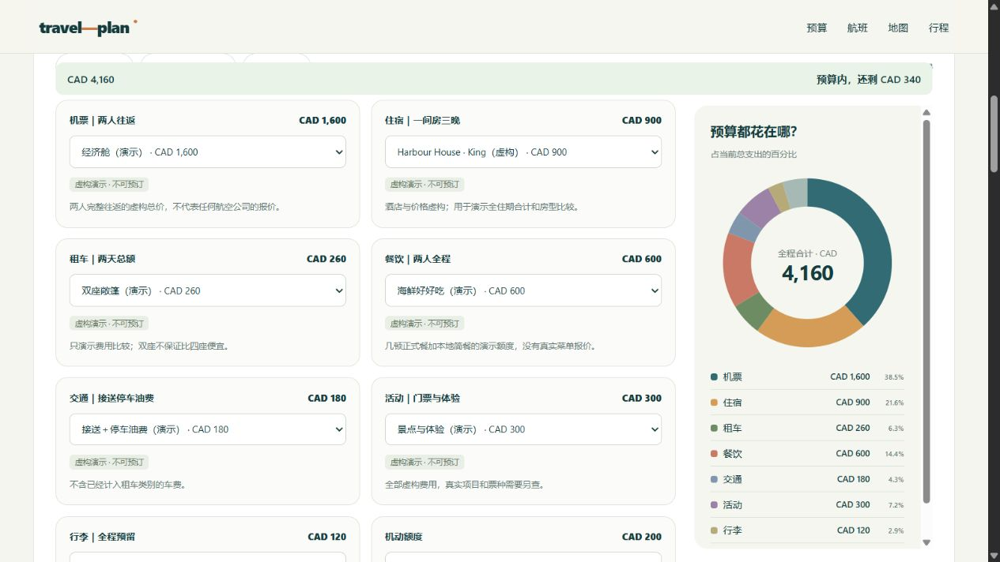

# travel-plan

**Turn scattered travel notes into a page you can plan together.**

[Live interactive demo](https://stevensun1005.github.io/travel-plan/demo/) · [中文 README](README.md) · [Skill instructions](SKILL.md)



A Codex skill with a buildless website starter. Merge PDFs and previous plans, research date-specific flight/hotel/car options, build realistic daily schedules, and let travelers compare choices with a live budget and spending chart.

- **Real geography:** Leaflet, OpenStreetMap, cached OSRM road geometry, daily filters and directions.
- **Useful choices:** compare whole-trip options, edit custom amounts and budget limits, see percentages, save locally.
- **Research that keeps its limits:** price records, estimates and bookings remain distinct; taxes, luggage, age restrictions and rental periods matter.
- **Coverage you can inspect:** every requested source item is scheduled, replaced, optional or explicitly excluded.
- **Shareable output:** validate, package only required files, publish through available authorized hosting tools.

The demo uses real public landmarks with **fictional hotels, prices, flights and times**. Nothing in it is a bookable quote.

## Install

Requires Python 3.10+ and a skill-enabled Codex environment. No npm install or API key is needed for the starter demo.

```bash
git clone https://github.com/stevensun1005/travel-plan.git
cd travel-plan
python scripts/install.py
```

Then invoke `$travel-plan`. The installer preserves an existing skill directory instead of overwriting it.

## Try it

```bash
python scripts/create_trip.py ./my-trip --demo
python scripts/validate_trip.py ./my-trip
python scripts/serve.py ./my-trip
```

Open the actual URL printed by the server. Map tiles require internet access. Omit `--demo` for a blank trip.

```bash
python scripts/fetch_routes.py ./my-trip
python scripts/package_site.py ./my-trip ./site-output
```

Edit one `trip-data.json`. See [data contract](references/data.md), [research rules](references/research.md), and [sharing workflow](references/sharing.md).

“Live budget” means immediate local calculation, not continuous provider repricing. Choices are saved in each browser and do not automatically sync between travelers. Publishing requires an available hosting service and the appropriate authorization; localhost is not a remote sharing link.

## Checks

```bash
python -m unittest discover -s tests -p "test_*.py"
node --test tests/budget.test.mjs
node --check assets/starter/app.mjs
```

MIT licensed. Component and map licenses are retained in [THIRD_PARTY_NOTICES.md](THIRD_PARTY_NOTICES.md).
