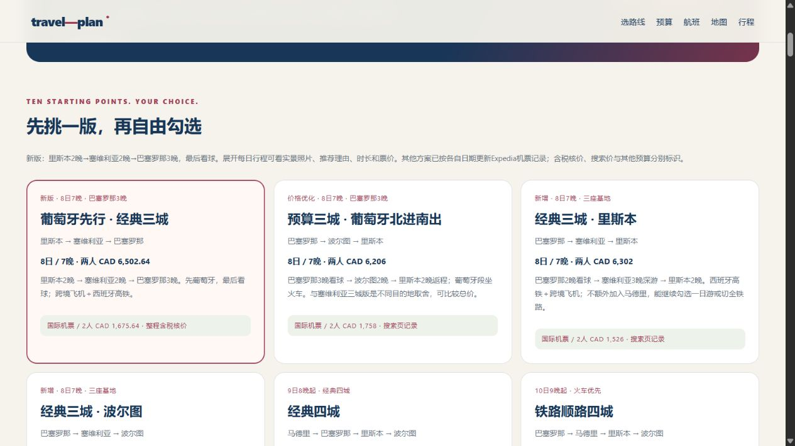

# travel-plan

**Turn scattered travel notes into a page you can plan together.**

[Public starter demo](https://stevensun1005.github.io/travel-plan/demo/) · [Iberia showcase](#spain--portugal-a-trip-built-around-matchday) · [中文 README](README.md) · [Skill instructions](SKILL.md)


A Codex skill with a buildless website starter. Merge PDFs and previous plans, research date-specific flight/hotel/car options, build realistic daily schedules, and let travelers compare choices with a live budget and spending chart.

- **Real geography:** Leaflet, OpenStreetMap, cached OSRM road geometry, daily filters and directions.
- **Useful choices:** compare whole-trip options, edit custom amounts and budget limits, see percentages, save locally.
- **Research that keeps its limits:** price records, estimates and bookings remain distinct; taxes, luggage, age restrictions and rental periods matter.
- **Coverage you can inspect:** every requested source item is scheduled, replaced, optional or explicitly excluded.
- **Shareable output:** validate, package only required files, publish through available authorized hosting tools.

The demo uses real public landmarks with **fictional hotels, prices, flights and times**. Nothing in it is a bookable quote.

For multi-city requests, the agent can extend the starter with city/night/order choices, rail-versus-flight options, event-anchored scheduling, and linked dates, lodging, maps and costs. Attraction details include photos, reasons to visit, duration and ticket information across every route. Expedia research follows the requested itinerary; mismatched quotes become estimates again while manual budgets survive. See [multi-city workflow](references/multi-city.md). These extensions are task-specific; the public starter demo remains a separate, smaller example.

## Spain × Portugal: a trip built around matchday

**Ten starting points. Your own route.** Lisbon → Seville → Barcelona is one option; choose other cities, change nights, or compare rail and flights while the schedule, map and budget follow along.

[](https://spain-barca-matchweek-jan2027.stezero.chatgpt.site/)

- **Choose and combine:** city checkboxes, route order, nights, day trips and transport by leg.
- **Keep matchday central:** event-based scheduling with tentative dates clearly identified.
- **Compare the whole trip:** Expedia records and estimates remain separate; airfare, local travel and lodging all affect value.
- **See the place before you go:** expandable attraction photos, reasons to visit, suggested duration, ticket information and official links.

<details>
<summary><strong>Preview the attraction cards</strong></summary>


</details>

[**Open the Iberia case study →**](https://spain-barca-matchweek-jan2027.stezero.chatgpt.site/) · [Route selector](https://spain-barca-matchweek-jan2027.stezero.chatgpt.site/#choose)

The case study retains its existing access controls: sign-in and site permission are required. Screenshots are visible here without site access. Captured from the existing local project on 2026-10-31; fare records are dated 2026-10-30 and are not current-price or booking guarantees. [Photo licensing](THIRD_PARTY_NOTICES.md#案例截图中的照片).

## Install

Requires Python 3.10+ and a skill-enabled Codex environment. No npm install or API key is needed for the starter demo.

```bash
git clone https://github.com/stevensun1005/travel-plan.git
cd travel-plan
python scripts/install.py
```

Then invoke `$travel-plan`. The installer preserves an existing skill directory instead of overwriting it.

## Try it

```bash
python scripts/create_trip.py ./my-trip --demo
python scripts/validate_trip.py ./my-trip
python scripts/serve.py ./my-trip
```

Open the actual URL printed by the server. Map tiles require internet access. Omit `--demo` for a blank trip.

```bash
python scripts/fetch_routes.py ./my-trip
python scripts/package_site.py ./my-trip ./site-output
```

Edit one `trip-data.json`. See [data contract](references/data.md), [research rules](references/research.md), and [sharing workflow](references/sharing.md).

“Live budget” means immediate local calculation, not continuous provider repricing. Choices are saved in each browser and do not automatically sync between travelers. Publishing requires an available hosting service and the appropriate authorization; localhost is not a remote sharing link.

## Checks

```bash
python -m unittest discover -s tests -p "test_*.py"
node --test tests/budget.test.mjs
node --check assets/starter/app.mjs
```

MIT licensed. Component and map licenses are retained in [THIRD_PARTY_NOTICES.md](THIRD_PARTY_NOTICES.md).
