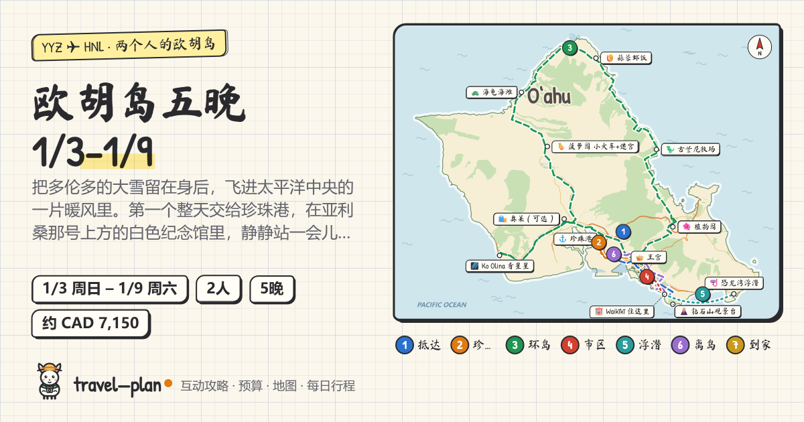
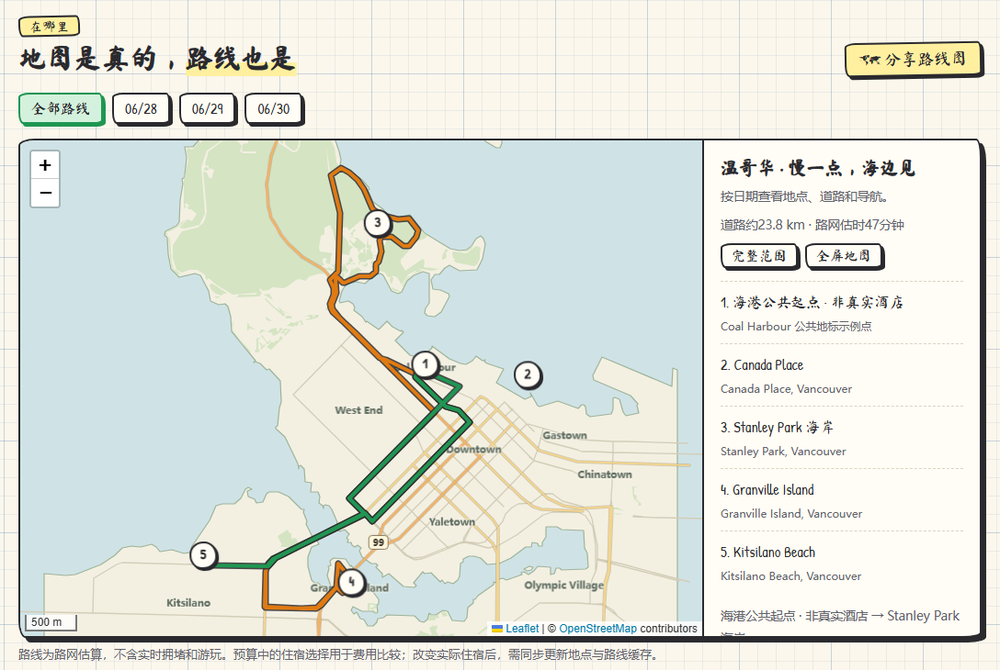

<div align="center">

<a href="https://stevensun1005.github.io/travel-plan/demo/"></a>

[](https://github.com/stevensun1005/travel-plan/actions/workflows/check.yml)


[](LICENSE)

[**欧胡岛演示 →**](https://stevensun1005.github.io/travel-plan/demo/) · [**哥斯达黎加演示 →**](https://stevensun1005.github.io/travel-plan/costa-rica/) · [一句话安装](#一句话安装) · [English](README.en.md)

</div>

---

出门前的资料总是散的：一份旧 PDF，几张机票截图，收藏夹里的景点，还有「别太赶」「预算别爆」「她不爬山」这些只在聊天里提过一句的话。

**travel-plan** 是给 Claude 和 Codex 用的旅行规划 skill。把这些都交给它：它去查真实的价格和路线，排出每天走得动的行程，最后交给你一个网页。机票酒店可以自己挑，预算跟着变，地图上是真的路，链接发给同伴就能一起看、一起选。

## 两份真实攻略

| [](https://stevensun1005.github.io/travel-plan/demo/) | [](https://stevensun1005.github.io/travel-plan/costa-rica/) |
| :--- | :--- |
| **欧胡岛 · 一月五晚**<br>把多伦多的大雪留在身后：在珍珠港前静静站一会儿，绕岛看海龟和星河，再乘帆船追一次落日。 | **哥斯达黎加 · 1/6–1/11**<br>逃离多伦多的冰雪，一路向南：两晚枕着太平洋的海浪，三晚住在火山脚下的温泉边。 |

两份都是用 travel-plan 给两个人做的真实攻略，点图片就能打开，不用登录。价格是 2026 年 11 月中旬查到的报价记录和估算，**全部没有预订**，以下单页面为准。

## 一句话安装

不想自己敲命令？把下面这段整段复制，发给你正在用的 Claude Code 或 Codex，它会自己装好：

```text
帮我安装 travel-plan 旅行规划 skill：https://github.com/stevensun1005/travel-plan
- 如果你是 Claude Code：运行 git clone https://github.com/stevensun1005/travel-plan ~/.claude/skills/travel-plan
- 如果你是 Codex：把仓库 git clone 到一个临时文件夹，进去运行 python scripts/install.py
- 已经装过的话，就进安装好的文件夹 git pull 更新到最新版
装好后读一遍里面的 SKILL.md，告诉我怎么开始做第一份旅行攻略。
```

在 claude.ai 网页或桌面 App 里用，看下面的[安装](#安装)。

## 它会帮你做什么

### 查价：同一张票，多比几家

- 先问你要不要直飞、有没有想坐的航司，再去航司官网、Trip.com / 携程、Booking.com、Expedia、Vio 查同一个航班、同一间房，挑最便宜的，并写明是在哪家查到的。
- 机票一律按每人带一件随身行李箱来比；外币按加拿大央行汇率换算。
- 每个价格都写查价日期，查不到就标成估算，不编报价。租车按驾驶人的真实年龄、驾照和租期算青年费和保险。

### 预算：两个人一起挑

- 机票、酒店、租车都做成可选方案，换一个选项，总价和余额马上重算，超过上限会提醒。
- 选了机酒套餐，酒店和接送自动变成「已含」，不会算两遍。
- 饼图每一块都能点开看明细，像记账软件一样；两家酒店、租车和油费这类分开选的，在饼图里可以合成一块看。
- 「换钱」一栏写清楚该带多少美元、多少当地货币，去哪换，哪些地方只收现金。

### 地图：真的路，不是示意线

- 地点用真实经纬度，路线来自 OpenStreetMap 路网，可以按天筛选，有分段里程和一键导航。
- 自带离线底图，托管环境拦住在线地图时，陆地、公路和地名照样在；缩到最小能看到世界地图，一键「和多伦多一起看」家和目的地隔多远。
- 观光巴士、游船、园区接驳车，不拿汽车最短路冒充。

### 行程和清单：照你们的节奏来

- 旧攻略、PDF、截图里提到的地方逐项合并，排进去的、换掉的、留作备选的、放弃的，都写清楚原因。
- 「她不 hiking」，就保留正常游览，只把山路换掉；「晚上别开远路」，长途就都放在白天。
- 出发前清单按每个人的护照和居留身份查签证和入境要求，再加上要提前抢的预订，按截止日排好，带倒计时。
- 清单和预算是连着的：在预算里换了酒店、航班或活动，清单里要订的东西跟着换；在清单里勾上「已订」，预算里对应的卡片变成绿色。
- 每个游玩项目右边可以点「夯 / 待定 / 额」，拿不准的（比如不一定想泡的温泉）先标待定，下面列好可以换的项目和价格。
- 「导入日历」一键把整个行程导入苹果日历（也支持 Google 日历、Outlook）：早上 9 点出发、下午 1 点到下一站，日历上就是 9:00–13:00 一段；跨时区的航班按两地真实时间算。
- 点过的选择会记下来：发成 Claude Artifact 时，同一账号换手机、电脑打开都能看到；在别处用顶栏「同步」的同步码或链接带过去。

### 分享：发出去好看，朋友也能做同款

- 「分享路线图」一键画出手绘海报：每天的路线、景点贴纸、每日亮点，右上角二维码，底部一只小羊驼。
- 发链接时显示一张带路线图的预览卡片，iMessage、WhatsApp、Telegram、Slack、Discord 和 claude.ai Artifact 都认。
- 顶栏一键切换中英文，英文页面不留一个中文字；方格纸和黑板两套主题；手机上专门重新排过版。
- 「做同款攻略」按钮会复制一段话，朋友粘贴给自己的 AI，就能做一份自己的。


| 地图自带离线底图 | 一键生成分享路线图 |
| :---: | :---: |
| [](docs/assets/map.png) | [](docs/assets/share-poster.png) |
| 公路分级 · 编号牌 · 山区绿地 · 城镇和海湾名 | 每天一种颜色 · 景点贴纸 · 每日卡片 · 一键保存 |

**多城市旅行也能做成选择器**：自由勾选城市、调整顺序和每城晚数、火车飞机二选一，日期、住宿、路线和预算一起联动；有必须参加的球赛或演出，就围绕它来排。详见[多城市工作流](references/multi-city.md)。

## 安装

网页本身不需要 npm install，也不需要 API key。本地工具需要 **Python 3.10+**；Node.js 18+ 只在开发时跑测试用。

### 在 Claude 里用（自动更新）

把 [`claude-skill/travel-plan`](claude-skill/travel-plan/SKILL.md) 这个文件夹打成 zip（里面是 `travel-plan/SKILL.md`），上传到 Claude 的 skills 设置里。它很短，只做一件事：每次启动先把这个仓库克隆或 `git pull` 到工作区的 `.skills/travel-plan`，再按仓库里完整的 `SKILL.md` 来做。所以只要上传一次，以后仓库更新自动生效；拉取失败就继续用已有的版本，不会动你的本地文件。

### 在 Codex 里用

```bash
git clone https://github.com/stevensun1005/travel-plan.git
cd travel-plan
python scripts/install.py
```

默认装到 `$CODEX_HOME/skills/travel-plan`，没设置时是 `~/.codex/skills/travel-plan`。目标位置已经有同名文件夹时，安装器会保留原文件并停下；可以用 `--destination` 换个位置。装好后在 Codex 里用 **`$travel-plan`** 调用。

## 复制一句话开始

**从零规划**

```text
用 $travel-plan 做一份两人海边旅行攻略：
从我的出发城市出发，五晚，含机票酒店活动的总预算有上限。
想吃海鲜、看海、浮潜，考虑敞篷车，不安排 hiking。
把酒店、机票和租车做成可选项，总预算和占比图随选择更新。
先沿用已经告诉你的信息，只问真正缺少的事项。
```

**合并旧资料**

```text
用 $travel-plan 把附件 PDF 里所有想去的地方合并到现有攻略。
晚数不变，取消我已经说不去的项目；排不下、换成替代或要看排队的都说明。
重新核对开放日、路线、预约和预算，并更新地图。
```

**查实际报价**

```text
用 $travel-plan 查指定日期、两位成人的机票和整段住宿的酒店总价。
租车按我的实际年龄、驾照和租期看含税含保险的总价。
给几档预算选项，标明查价日期、退改、行李、停车和还没核实的费用。
```

**分享给同伴**

```text
用 $travel-plan 把做好的攻略发布成有链接就能看的网页。
保留互动预算和地图，返回确认能打开的链接。
不要把原始资料、发布凭据和整个工作目录一起上传。
```

**多城自由组合**

```text
用 $travel-plan 做几版跨国路线，让我勾选城市、调整顺序和每城晚数。
优先火车，也保留飞机选项，围绕我必须参加的比赛来排。
按 Expedia 对应日期的完整票价比较性价比，条件变了就标明报价要重查。
每版的景点都附照片、为什么值得去、停留多久和门票价格。
改了选择后，日期、住宿、交通、地图和预算一起更新，保留我手填的金额。
```

## 不开 AI，也能先玩一下

```bash
python scripts/create_trip.py ./my-trip --demo
python scripts/validate_trip.py ./my-trip
python scripts/serve.py ./my-trip
```

打开命令打印出来的地址。`--demo` 是一份虚构的温哥华样例，带缓存好的道路线和离线底图；去掉 `--demo` 就是一份空白攻略。

```bash
# 改了 trip-data.json 之后，重新取真实道路线
python scripts/fetch_routes.py ./my-trip

# 离线底图；装了 shapely 时大陆海岸线也能填色，--detail full 会加上三级公路
python scripts/fetch_basemap.py ./my-trip

# 链接预览卡片；发布到固定网址时加 --url
python scripts/make_card.py ./my-trip --url https://你的网址/

# 只打包页面需要的文件，输出目录必须是新的或空的
python scripts/package_site.py ./my-trip ./site-output
```

整份攻略都写在一个 `trip-data.json` 里。字段见 [data.md](references/data.md)，查价和排程规范见 [research.md](references/research.md)，发布流程见 [sharing.md](references/sharing.md)。

## 预算为什么不会悄悄翻倍

- 往返机票是一个总价，不会去程、回程各算一遍。
- 酒店按整段住宿算；餐费、停车和强制收费写清楚算没算进去。
- 套餐里已经含的晚餐、门票、接送只算一次；机酒套餐会把被包含的酒店锁成「已含」。
- 行李费这类跟着航班变的金额，换航班时一起换。
- 全程用最小货币单位累加；负数、空值、损坏的保存记录都不会把总价算乱。
- 饼图只画「已经花出去的钱」，没花完的预算不混进去；每一类的明细加起来必须等于这一类的金额，校验器会查。
- 「换钱」是带多少现金的建议，不是另一笔开销，不进饼图。

## 常见问题

<details>
<summary>「实时预算」会自动抓机票和酒店的新价格吗？</summary>

不会。「实时」是指你换选项、改金额后马上重算。商家价格用的是写明日期的查价记录或估算；要更新价格，需要让 AI 重新去查。

</details>

<details>
<summary>有 PDF 就能直接导入吗？</summary>

能提取文字的 PDF 会先转成文字，必要时再看页面图片，然后把地点逐项排进去。扫描版 PDF 可能需要 OCR；读不出来的内容会直接告诉你，不会假装都读到了。

</details>

<details>
<summary>地图是真的，还是画个大概？</summary>

用 Leaflet、OpenStreetMap 和真实经纬度，道路线来自缓存的 OSRM 路网结果。没有道路数据时只显示地点和导航，不画虚构的曲线。

在线地图下面还垫着一层用 OpenStreetMap 数据生成的离线底图，所以发布到会拦截外部图片的地方，地图照样有陆地、湖泊、公路和地名；再往下是随页面打包的简化世界地图（Natural Earth，公有领域），缩到整个大洲也不会变成一片空白。国界只是示意。

</details>

<details>
<summary>发给同伴后，两个人的选择会同步吗？</summary>

不会。每个人的选择存在自己的浏览器里，互不覆盖。本机地址（`127.0.0.1`）只有自己能打开，要发给别人得先发布到能访问的托管服务。

</details>

<details>
<summary>它会帮我订票、付款或者发消息吗？</summary>

不会。做攻略不等于授权购买或代发消息，所有项目都保持「未预订」，发布和付款都要你自己确认。

</details>

<details>
<summary>只想改一个小地方，也要整个重跑吗？</summary>

不用。已有的攻略只改你说的那部分，之前的决定、清单和其他数据都保留。

</details>

## 开发与验证

```bash
python -m unittest discover -s tests -p "test_*.py"
node --test tests/budget.test.mjs
node --check assets/starter/app.mjs
node --check assets/starter/share-map.mjs
```

测试覆盖预算组合、行李联动、套餐锁定与释放、金额精度、零支出、损坏的保存记录、航班切换、数据和海报引用、离线底图生成（不联网，用样例数据）、预览卡片标签，以及打包时不会带上原始 PDF、`.env` 和发布凭据。

欢迎提具体的问题、能复现的行程边界情况，或者小而完整的 PR。新功能请附上能说明行为的测试；公开的样例请用虚构数据。

## 许可

[Apache-2.0](LICENSE)，附署名要求（[NOTICE](NOTICE)）。可以自由使用、修改和再发布，包括商用；**但任何复制、fork、移植或改写（包括用 AI 照着重写的版本），都要保留 `LICENSE`、`NOTICE` 和源文件顶部的出处注释，并在 README 或页面上写明：**

> Based on travel-plan by Steven Sun — https://github.com/stevensun1005/travel-plan

用 skill 给自己做攻略不需要额外操作：生成的页面自带出处注释、页脚 GitHub 链接、海报二维码和小羊驼。

2026-11-16 之前发布的版本是 MIT 许可，那些版本的副本仍按 MIT（同样要保留版权声明）。地图数据和随包组件遵循各自的许可，见 [THIRD_PARTY_NOTICES.md](THIRD_PARTY_NOTICES.md)。
