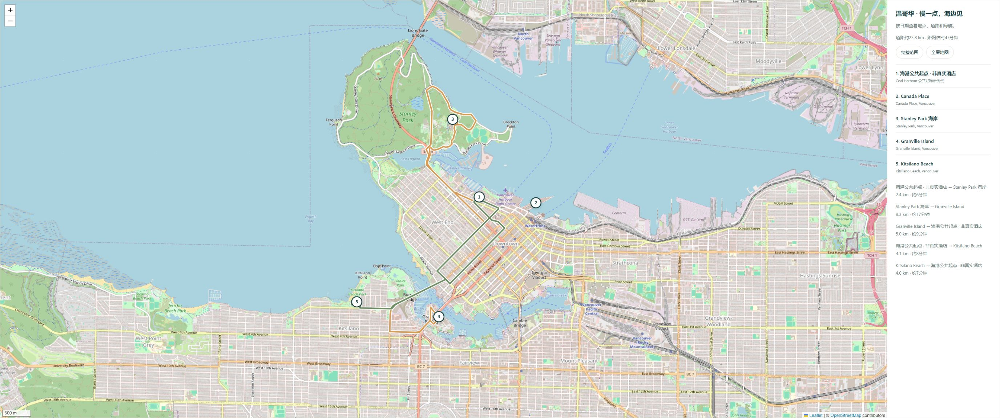

<div align="center">


**把旅行资料，变成你们真的会打开的攻略。**

机票怎么选 · 酒店住哪里 · 钱花去哪了 · 每天怎么走

[](https://github.com/stevensun1005/travel-plan/actions/workflows/check.yml)


[](LICENSE)

[**打开互动演示 →**](https://stevensun1005.github.io/travel-plan/demo/) · [三步安装](#三步安装) · [复制一句话开始](#复制一句话开始) · [English](README.en.md)

</div>

---

你有一份旧PDF、几张机票截图、一串想去的地方，还有「别太赶」「吃好一点」「预算别爆」这些真实需求。

**travel-plan** 是给 Codex 使用的旅行规划 skill。它把这些资料整理成一份能看地图、切换机酒方案、实时算预算、发给同伴的网页。交付包含可编辑数据、网页和校验工具，不只是一段聊天记录。

## 先看看成品


<details>
<summary><strong>展开看真实路线地图</strong></summary>



</details>

> 演示使用温哥华公共地标。**酒店、价格、航班和时刻全部虚构，不能预订。** 地图与道路线用于展示功能；你自己的攻略会按实际资料与可取得的报价制作。

## 这份 skill 会多做哪一步

| 你会说的话 | travel-plan 会落实成什么 |
| --- | --- |
| 「我还有一份旧攻略，都加进去」 | 逐项提取、去重与覆盖表，交代安排、替代、备选和取消 |
| 「回来转两次机也行，想省钱」 | 对应日期与人数的全程报价，比较舱等、转机、到家日和行李 |
| 「想租双座敞篷，我还不到25」 | 按年龄、门店、车型、实际租期查资格与完整总价，不猜青年费 |
| 「她能正常走，只是不hiking」 | 保留正常参观与上下车，把山顶步道改成明确的外围体验 |
| 「地图别再画个大概」 | 经纬度、真实底图、缓存道路线、每日筛选、分段里程和导航 |
| 「酒店机票让我自己选」 | 可选方案、自定义金额、预算上限、总额/余额与支出占比联动 |
| 「跨年有什么特别的」 | 核对本年度活动、节日关闭、晚秀与游船冲突，区分常规节目 |
| 「怎么发给同伴」 | 白名单静态打包；按授权部署并交付确认成功的分享链接 |

**也支持把多城旅行做成选择器。** 用户需要时，Agent会扩展底板：自由勾选城市、改晚数和顺序、切换火车/飞机，联动日期、住宿、路线和预算；围绕球赛等必参加事件排程。景点详情就近展开照片、推荐理由、停留时间及门票，所有备选线路使用同样标准。指定Expedia时按对应行程核价，改条件会使不匹配报价失效，并保留手填预算。详见 [多城市工作流](references/multi-city.md)；当前在线演示展示基础底板。

## 三步安装

需要支持 skill 的 Codex，以及用于本地工具的 **Python 3.10+**。网页底板不需要npm install，也不需要API key。Node.js 18+仅用于开发校验和JS测试。

```bash
git clone https://github.com/stevensun1005/travel-plan.git
cd travel-plan
python scripts/install.py
```

默认安装到 `$CODEX_HOME/skills/travel-plan`，未设置时为 `~/.codex/skills/travel-plan`。安装器遇到同名目录会保留原文件并停止；可用 `--destination` 指定另一位置。安装后在 Codex 中用 **`$travel-plan`** 调用。

## 复制一句话开始

**从零规划**

```text
用 $travel-plan 做一份两人海边旅行攻略：
从我的出发城市出发，五晚，含机票酒店活动的总预算有上限。
想吃海鲜、看海、浮潜，考虑敞篷车，不安排hiking。
把酒店、机票和租车做成可选项，总预算和占比图随选择更新。
先沿用已经告诉你的信息，只问真正缺少的事项。
```

**合并旧资料**

```text
用 $travel-plan 把附件PDF里的所有想去地点合并到现有攻略。
晚数不变，取消我已经说不做的项目；排不下、改成替代或视排队的要说明。
重新核对开放日、路线、预约和预算，并更新真实地图。
```

**查实际报价**

```text
用 $travel-plan 查指定日期、两位成人的机票和全住期酒店总价。
租车按我实际年龄、驾照和租期看含税保障总价。
给不同预算选项，标明查价日期、退款、行李、停车及尚未核实的费用。
```

**分享给同伴**

```text
用 $travel-plan 把已经完成的攻略发布成有链接即可查看的网页。
保留互动预算和地图，返回确认成功的线上链接。
不要把原始资料、发布凭据和整个工作目录一起上传。
```

**多城自由组合**

```text
用 $travel-plan 做几版跨国路线，让我勾选城市、调整顺序和每城晚数。
优先火车，也保留飞机选项，围绕我必须参加的比赛排程。
按 Expedia 的对应日期完整票价比较性价比，变更条件后标明报价需重查。
各版景点都在展开日程里附照片、为什么值得去、停留时间和门票价格。
改选择后同步日期、住宿、交通、地图和预算，保留我手填的金额。
```

## 不开AI，也能先玩一下

```bash
python scripts/create_trip.py ./my-trip --demo
python scripts/validate_trip.py ./my-trip
python scripts/serve.py ./my-trip
```

打开命令实际打印的URL。演示包含缓存道路线；地图底图需要联网。生成空白旅行时去掉 `--demo`。

```bash
# 修改 trip-data.json 后，按需取得真实公路几何
python scripts/fetch_routes.py ./my-trip

# 只打包页面需要的文件，输出目录必须为新目录或空目录
python scripts/package_site.py ./my-trip ./site-output
```

### 一份输入，几个清楚的出口

```text
需求 / PDF / 旧攻略 / 报价记录
                ↓
       提取 → 查证 → 排程 → 取舍
                ↓
         trip-data.json
                ↓
    互动预算 + 航班 + 真实地图 + 每日行程
                ↓
       本地查看 / 静态打包 / 授权发布
```

研究规范见 [research.md](references/research.md)，字段见 [data.md](references/data.md)，分享流程见 [sharing.md](references/sharing.md)。

## 预算为什么不会悄悄翻倍

- 机票是一份完整往返总价，不把去程卡与回程卡各算一遍。
- 酒店按全住期计算；餐费、停车、强制费用的口径写清楚。
- 套餐已含的晚餐、门票和接送只计一次。
- 行李等有依赖的金额随所选航班调整。
- 用最小货币单位累计，自定义负数、损坏的保存内容和零预算都有处理。
- 饼图是**当前支出构成**；未用预算不混成一块“支出”。

## 常见问题

<details>
<summary>“实时预算”会自动抓机票和酒店的新价格吗？</summary>

不会。实时是指你选择方案或修改金额后立即重算。商家价格沿用明确注明日期的查价记录或估算，重新查价需要Agent访问可用的实时来源。

</details>

<details>
<summary>有PDF就能直接导入吗？</summary>

有可用的PDF提取能力时，skill会先转为文字/Markdown，必要时查看页面图像，再把地点逐项纳入。图片型PDF可能需要OCR；它不会把无法识别的内容假装已完整读到。

</details>

<details>
<summary>地图到底是真实的，还是装饰性的示意图？</summary>

使用Leaflet、OpenStreetMap和真实经纬度；道路线来自缓存OSRM结果。没有路由数据就先显示地点和导航，不画虚构曲线。游船、接驳、军事基地和观光巴士不会用汽车最短路冒充。

</details>

<details>
<summary>发给同伴后，两人的预算选择会同步吗？</summary>

各自保存在各自的浏览器，不会互相覆盖，也不自动同步。`127.0.0.1`只能本机访问；要异地分享需要部署到可访问的托管服务。发布能力取决于当前环境的工具与授权。

</details>

<details>
<summary>它会直接订票、付款或帮我发消息吗？</summary>

不会把“制作攻略”理解成购买或代发权限。所有未预订的项目保留未预订状态，发布和付款也遵循各自实际授权。

</details>

<details>
<summary>我只有一个很小的修改，也要重跑全部流程吗？</summary>

不用。已有项目按当前请求定向修改，保留历史决定、清单和无关数据。只做适合本次变更的验证。

</details>

## 开发与验证

```bash
python -m unittest discover -s tests -p "test_*.py"
node --test tests/budget.test.mjs
node --check assets/starter/app.mjs
```

测试覆盖预算组合、行李联动、金额精度、零支出、损坏保存内容、航班容器偏移、数据引用，以及静态包不包含原始PDF、`.env`和托管身份。浏览器交互与远端CI状态分开验证。

欢迎提交具体问题、可复现的行程边界案例，或小而完整的PR。新功能请附能说明行为的检查；公开fixture使用虚构数据。

## License

[MIT](LICENSE)。地图与随包组件遵循各自许可，见 [THIRD_PARTY_NOTICES.md](THIRD_PARTY_NOTICES.md)。
